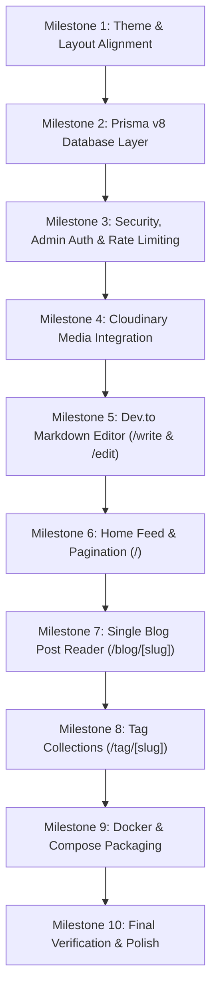

# Agile Development Plan: minimal-blog

This step-by-step development roadmap breaks down the construction of `minimal-blog` into incremental, testable milestones. Following this agile plan ensures that every stage delivers functioning, verifiable capabilities without regressions.

---

## ✦ Milestone Overview

---

## Milestone 1: Theme & Layout Alignment
**Goal**: Mirror the visual aesthetic of `ishanjarwal.com` with zero border radius, monospace font, GitHub-style colors, light/dark switcher, and persistent Header/Footer.

- [x] **Task 1.1**: Configure `globals.css` theme tokens
  - Preserve exact shadcn CSS variable names without custom names to maintain full shadcn compatibility.
  - Update values to GitHub README light (`#f6f8fa`) and dark (`#010409`) palettes.
  - Enforce `--radius: 0rem` and 0px radius tokens across UI.
  - Strictly avoid arbitrary hex color classes across the codebase.
- [x] **Task 1.2**: Set up `ThemeProvider` and Root Layout
  - Implement `next-themes` provider in `src/components/theme-provider.tsx` (suppress hydration warnings, default to light).
  - Update `src/app/layout.tsx` to include Google font `Geist_Mono` and global styles.
- [x] **Task 1.3**: Build Global Header & Navigation
  - Create `src/components/layout/header.tsx` with avatar thumbnail, `~/ ishanjarwal / blog` brand link, bracketed navigation (`[Home]`, `[Tags]`, `[Portfolio]`), and responsive mobile drawer.
  - Create `src/components/layout/theme-toggle.tsx` with monospace icon/button.
- [x] **Task 1.4**: Build Global Footer
  - Create `src/components/layout/footer.tsx` with top border, copyright, social links (GitHub, LinkedIn), and smooth `[Back to top ↑]`.
- [x] **Task 1.5**: Direct Article Feed on Homepage
  - Remove redundant introductory bio/picture block on `/`; start directly with `## Latest Articles`.
  - Implement feed card layout with optional, conditional thumbnail rendering.
- [x] **Verification**:
  - Run `npm run build` and `npm run lint`.
  - Confirm instant theme transitions without flicker, hydration errors, or layout shifts.

---

## Milestone 2: Prisma v8 Database Layer
**Goal**: Set up Prisma v8 with PostgreSQL, configure models for posts and tags, and verify database connectivity.

- [x] **Task 2.1**: Initialize Prisma v8
  - Install `@prisma/client@8.1.0-dev.10`, `prisma@8.1.0-dev.10`, and `@prisma/adapter-pg`.
  - Configure `prisma.config.ts` and `prisma/schema.prisma` with `Post`, `Tag`, and `PostTag` models and optimized indexes.
- [x] **Task 2.2**: Configure Prisma Client Singleton
  - Create `src/lib/db.ts` utilizing `pg.Pool` and `PrismaPg` adapter with singleton pattern to prevent duplicate pool/client instantiations.
- [x] **Task 2.3**: Database Migration & Seed Script
  - Create `prisma/seed.ts` with initial mock technical posts with tags.
  - Add `"prisma": { "seed": "tsx prisma/seed.ts" }` and convenience `db:*` scripts in `package.json`.
- [x] **Verification**:
  - Run `npm run db:push` to sync database schema.
  - Run `npm run db:seed` and verify records populated in PostgreSQL.

---

## Milestone 3: Security, Admin Auth & VPS Rate Limiting
**Goal**: Protect the personal blog's write and mutation operations without bloated user authentication, and protect the VPS from spam.

- [x] **Task 3.1**: Admin Passkey Authentication System
  - Define `ADMIN_SECRET_KEY` in environment variables.
  - Build `src/lib/auth.ts` with timing-safe passkey verification and signed HMAC session cookies (`blog_admin_session`).
  - Create Admin Challenge page (`/admin`) for entering the passkey.
  - Implement Server Actions (`loginAdminAction`, `logoutAdminAction`, `getAdminStatus`).
- [x] **Task 3.2**: In-Memory Sliding Window Rate Limiter
  - Create `src/lib/rate-limit.ts` providing an in-memory sliding window algorithm with automated garbage collection.
  - Configure limits: 10 requests/min for write/upload endpoints; 5 requests/min for admin login attempts.
- [x] **Task 3.3**: Next.js Proxy/Middleware Guard
  - Create `src/proxy.ts` to enforce rate limits on API requests and redirect unauthenticated attempts to `/write` or `/blog/[slug]/edit`.
  - Add standard HTTP security headers (CSP, X-Frame-Options, X-Content-Type-Options).
- [x] **Verification**:
  - Visit `/write` without authentication; verified 307 redirection to `/admin`.
  - Enter valid passkey; session cookie issued and redirects.

---

## Milestone 4: Cloudinary Media Integration
**Goal**: Enable seamless, direct image uploading for blog thumbnails and inline post screenshots.

- [x] **Task 4.1**: Configure Cloudinary SDK
  - Install `cloudinary` and configure `src/lib/cloudinary.ts` with credentials.
- [x] **Task 4.2**: Build Secure Upload Route Handler
  - Create `src/app/api/media/upload/route.ts` requiring admin authorization.
  - Accept `multipart/form-data`, validate file size (< 10MB) and MIME types (png, jpg, webp, gif, svg).
  - Upload file to designated Cloudinary folder and return secure HTTPS URL.
- [x] **Verification**:
  - Verify route rejects unauthenticated requests with 401.

---

## Milestone 5: Dev.to-Style Markdown Editor & Post Management
**Goal**: Build a simple, dual-tab (Write/Preview) editor to publish and update blog posts.

- [x] **Task 5.1**: Markdown Renderer Component
  - Install `react-markdown`, `remark-gfm`, `rehype-highlight`, and `rehype-sanitize`.
  - Create `src/components/markdown/markdown-renderer.tsx` with GitHub typography, copy-to-clipboard code fences, and responsive YouTube video embeds.
- [x] **Task 5.2**: Dev.to-Style Editor Component
  - Create `src/components/editor/devto-editor.tsx` featuring:
    - Tab switch: `[Write]` (raw textarea with markdown shortcuts) vs `[Preview]` (live rendered output).
    - Image upload button triggering Cloudinary upload and inserting ``.
    - Video embed helper button.
    - Optional thumbnail upload and live preview.
- [x] **Task 5.3**: Post Creation Page (`/write`)
  - Build `src/app/(admin)/write/page.tsx` with title, auto-slug, short description, tags, status toggle, and Server Action `savePostAction`.
- [x] **Task 5.4**: Post Update Page (`/blog/[slug]/edit`)
  - Build `src/app/(admin)/blog/[slug]/edit/page.tsx` preloaded with the post's current data.
- [x] **Verification**:
  - Validated with TypeScript compiler and Next.js standalone build.

---

## Milestone 6: Home Feed & Pagination (`/`)
**Goal**: Deliver a clean, paginated home feed of published posts matching the portfolio style.

- [x] **Task 6.1**: Home Page Live Database Query
  - Query published posts from PostgreSQL ordered by `publishedAt DESC` with tag relations.
  - Implement clean feed cards with date, estimated read time, tags, and conditional thumbnail.
- [x] **Task 6.2**: Pagination Controls
  - Implement page-based navigation (`?page=1`, `?page=2`) with Previous/Next buttons and monospace brackets.
- [x] **Verification**:
  - Confirmed live database query pulling all 4 seeded articles with pagination.

---

## Milestone 7: Single Blog Post Reader (`/blog/[slug]`)
**Goal**: Present an immaculate reading experience for technical articles.

- [x] **Task 7.1**: Blog Post Page & Metadata
  - Build `src/app/(public)/blog/[slug]/page.tsx` with dynamic SEO and OpenGraph metadata.
  - Render publication date, updated date, read time, and tags.
- [x] **Task 7.2**: Full Content Rendering & Code Highlighting
  - Render post content via `MarkdownRenderer`.
  - Render author bio card with portfolio links matching `ishanjarwal.com`.
  - Conditional `[Edit Article]` action for authenticated admin.
- [x] **Verification**:
  - Curled `/blog/understanding-linux-memory-management` and verified HTML output.

---

## Milestone 8: Tag Collections (`/tag/[slug]`)
**Goal**: Allow visitors to browse articles grouped by topic.

- [x] **Task 8.1**: Tag Feed Page
  - Build `src/app/(public)/tag/[slug]/page.tsx` querying posts matching tag slug.
- [x] **Task 8.2**: Tag Directory
  - Build `src/app/(public)/tag/page.tsx` showing all active tags with article count badges.
- [x] **Verification**:
  - Curled `/tag/linux` and `/tag` and verified filtered results.

---

## Milestone 9: Docker & Compose Packaging
**Goal**: Provide production-ready containerization for VPS deployment with separate development and production profiles.

- [x] **Task 9.1**: Multi-stage `Dockerfile`
  - Enabled Next.js `output: "standalone"` in `next.config.ts`.
  - Multi-stage Dockerfile: `deps` -> `builder` -> `runner`.
- [x] **Task 9.2**: Compose File Suite
  - Created `compose.yml` (base services: `app` and `db`, network, volumes, healthcheck).
  - Created `compose.dev.yml` (development overrides with live volume mounts and ports).
  - Created `compose.prod.yml` (production overrides with internal-only DB ports and auto-restart).
- [x] **Task 9.3**: Environment Configuration Files
  - Configured `.dockerignore`, `.env.example`, `.env.development`, `.env.production`.
- [x] **Verification**:
  - Validated both dev and prod compose configs with `docker compose config`.

---

## Milestone 10: Final Verification & Polish
**Goal**: Verify all quality gates, type safety, security protections, and user flows.

- [ ] **Task 10.1**: Automated Checks
  - Run `npm run lint` and verify zero errors.
  - Run `npx tsc --noEmit` and verify complete type safety.
  - Run `npm run build` and ensure successful standalone build.
- [ ] **Task 10.2**: End-to-End User Flow Walkthrough
  - Switch light/dark themes.
  - Browse home feed and navigate paginated pages.
  - Read individual post and test code snippet copying.
  - Filter by tags.
  - Log in via admin passkey.
  - Create a new blog post with an uploaded image and published status.
  - Edit an existing blog post.
  - Test rate limiting on mutation endpoints.
