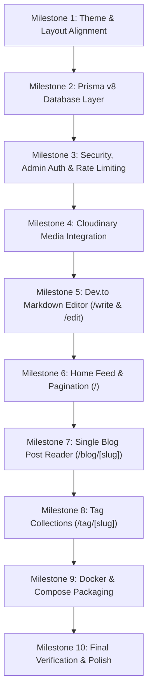

# Agile Development Plan: minimal-blog

This step-by-step development roadmap breaks down the construction of `minimal-blog` into incremental, testable milestones. Following this agile plan ensures that every stage delivers functioning, verifiable capabilities without regressions.

---

## ✦ Milestone Overview

---

## Milestone 1: Theme & Layout Alignment
**Goal**: Mirror the visual aesthetic of `ishanjarwal.com` with zero border radius, monospace font, GitHub-style colors, light/dark switcher, and persistent Header/Footer.

- [x] **Task 1.1**: Configure `globals.css` theme tokens
  - Preserve exact shadcn CSS variable names without custom names to maintain full shadcn compatibility.
  - Update values to GitHub README light (`#f6f8fa`) and dark (`#010409`) palettes.
  - Enforce `--radius: 0rem` and 0px radius tokens across UI.
  - Strictly avoid arbitrary hex color classes across the codebase.
- [x] **Task 1.2**: Set up `ThemeProvider` and Root Layout
  - Implement `next-themes` provider in `src/components/theme-provider.tsx` (suppress hydration warnings, default to light).
  - Update `src/app/layout.tsx` to include Google font `Geist_Mono` and global styles.
- [x] **Task 1.3**: Build Global Header & Navigation
  - Create `src/components/layout/header.tsx` with avatar thumbnail, `~/ ishanjarwal / blog` brand link, bracketed navigation (`[Home]`, `[Tags]`, `[Portfolio]`), and responsive mobile drawer.
  - Create `src/components/layout/theme-toggle.tsx` with monospace icon/button.
- [x] **Task 1.4**: Build Global Footer
  - Create `src/components/layout/footer.tsx` with top border, copyright, social links (GitHub, LinkedIn), and smooth `[Back to top ↑]`.
- [x] **Task 1.5**: Direct Article Feed on Homepage
  - Remove redundant introductory bio/picture block on `/`; start directly with `## Latest Articles`.
  - Implement feed card layout with optional, conditional thumbnail rendering.
- [x] **Verification**:
  - Run `npm run build` and `npm run lint`.
  - Confirm instant theme transitions without flicker, hydration errors, or layout shifts.

---

## Milestone 2: Prisma v8 Database Layer
**Goal**: Set up Prisma v8 with PostgreSQL, configure models for posts and tags, and verify database connectivity.

- [ ] **Task 2.1**: Initialize Prisma v8
  - Install `@prisma/client` and `prisma` CLI.
  - Configure `prisma/schema.prisma` with `Post`, `Tag`, and `PostTag` models and optimized indexes.
- [ ] **Task 2.2**: Configure Prisma Client Singleton
  - Create `src/lib/db.ts` to prevent duplicate client instantiations in Next.js development hot-reloading.
- [ ] **Task 2.3**: Database Migration & Seed Script
  - Create `prisma/seed.ts` with initial mock technical posts (e.g., "Understanding Linux Memory Management", "Building Agentic Systems") with tags.
  - Add `"prisma": { "seed": "tsx prisma/seed.ts" }` in `package.json`.
- [ ] **Verification**:
  - Run `npx prisma db push` or `npx prisma migrate dev`.
  - Run `npx prisma db seed` and confirm database records using Prisma Studio (`npx prisma studio`).

---

## Milestone 3: Security, Admin Auth & VPS Rate Limiting
**Goal**: Protect the personal blog's write and mutation operations without bloated user authentication, and protect the VPS from spam.

- [ ] **Task 3.1**: Admin Passkey Authentication System
  - Define `ADMIN_SECRET_KEY` in environment variables.
  - Build `src/lib/auth.ts` with cookie verification, passkey comparison, and session token generation (`blog_admin_token`).
  - Create Admin Challenge dialog/page (`/admin`) for entering the passkey.
  - Build logout and session status indicators.
- [ ] **Task 3.2**: In-Memory Sliding Window Rate Limiter
  - Create `src/lib/rate-limit.ts` providing an in-memory token bucket algorithm.
  - Configure limits: 10 requests/min for write/upload endpoints; 100 requests/min for public reads.
- [ ] **Task 3.3**: Next.js Middleware Guard
  - Create `middleware.ts` to enforce rate limits on API requests and redirect unauthenticated attempts to `/write` or `/blog/[slug]/edit`.
  - Add standard HTTP security headers (CSP, X-Frame-Options, X-Content-Type-Options).
- [ ] **Verification**:
  - Visit `/write` without authentication; verify redirection to `/admin`.
  - Enter valid `ADMIN_SECRET_KEY`; verify successful authentication and cookie issuance.
  - Fire repeated requests to test rate limit 429 response.

---

## Milestone 4: Cloudinary Media Integration
**Goal**: Enable seamless, direct image uploading for blog thumbnails and inline post screenshots.

- [ ] **Task 4.1**: Configure Cloudinary SDK
  - Install `cloudinary` and configure `src/lib/cloudinary.ts` with credentials.
- [ ] **Task 4.2**: Build Secure Upload Route Handler
  - Create `src/app/api/media/upload/route.ts` requiring admin authorization.
  - Accept `multipart/form-data`, validate file size (< 10MB) and MIME types (png, jpg, webp, gif).
  - Upload file to designated Cloudinary folder and return secure HTTPS URL.
- [ ] **Task 4.3**: Build UI Media Uploader Helper
  - Create `src/components/editor/media-uploader.tsx` for one-click upload with thumbnail preview and markdown insertion.
- [ ] **Verification**:
  - Upload a test image through the API endpoint or helper component.
  - Confirm the image appears in Cloudinary and the returned URL renders properly.

---

## Milestone 5: Dev.to-Style Markdown Editor & Post Management
**Goal**: Build a simple, dual-tab (Write/Preview) editor to publish and update blog posts.

- [ ] **Task 5.1**: Markdown Renderer Component
  - Install `react-markdown`, `remark-gfm`, `rehype-highlight` (or Shiki), and `rehype-sanitize`.
  - Create `src/components/markdown/markdown-renderer.tsx` with GitHub README typography styling and code syntax highlighting.
  - Add support for video embeds (YouTube iframes, responsive player).
- [ ] **Task 5.2**: Dev.to-Style Editor Component
  - Create `src/components/editor/devto-editor.tsx` featuring:
    - Tab switch: `[Write]` (raw textarea with markdown shortcuts) vs `[Preview]` (live rendered output).
    - Image upload button triggering Cloudinary upload and inserting ``.
    - Video embed helper button.
- [ ] **Task 5.3**: Post Creation Page (`/write`)
  - Build `src/app/(admin)/write/page.tsx` with:
    - Title input with auto-generated slug (with manual edit override).
    - Short description textarea.
    - Thumbnail URL input with upload button.
    - Tags input (comma-separated or badge selector).
    - Status toggle (Draft vs. Published).
  - Server Action to validate inputs with Zod and save to PostgreSQL via Prisma.
- [ ] **Task 5.4**: Post Update Page (`/blog/[slug]/edit` & `/write/[id]`)
  - Build `src/app/(admin)/blog/[slug]/edit/page.tsx` preloaded with the post's current data.
  - Server Action to update post, recalculate read time, and revalidate paths.
- [ ] **Verification**:
  - Log in as admin, navigate to `/write`.
  - Write a markdown post with headers, code blocks, uploaded image, and tags.
  - Preview in the `Preview` tab.
  - Publish the post and verify record persistence in PostgreSQL.

---

## Milestone 6: Home Feed & Pagination (`/`)
**Goal**: Deliver a clean, paginated home feed of published posts matching the portfolio style.

- [ ] **Task 6.1**: Home Page Query & Post Card Component
  - Query published posts ordered by `publishedAt DESC` with relation to tags.
  - Create `src/components/blog/post-card.tsx`:
    - Title with hover underline.
    - Short description.
    - Meta banner: formatted date, estimated read time, thumbnail preview.
    - Clickable tag badges linking to `/tag/[slug]`.
- [ ] **Task 6.2**: Pagination Controls
  - Implement page-based navigation (`?page=1`, `?page=2`) with Previous/Next buttons and page numbers styled in monospace brackets (`[← Previous]`, `[Next →]`).
- [ ] **Task 6.3**: Bio / Intro Banner
  - Add a minimal intro card matching the portfolio README header (`# Hi, I'm Ishan Jarwal...`).
- [ ] **Verification**:
  - Test pagination with multiple seeded posts.
  - Verify drafts are excluded from public feed.

---

## Milestone 7: Single Blog Post Reader (`/blog/[slug]`)
**Goal**: Present an immaculate reading experience for technical articles.

- [ ] **Task 7.1**: Blog Post Page & Metadata
  - Build `src/app/(public)/blog/[slug]/page.tsx`.
  - Implement `generateMetadata` for dynamic SEO, OpenGraph tags, and Twitter cards.
  - Display full post header: title, publication date, last updated date, reading time, author banner.
- [ ] **Task 7.2**: Full Content Rendering & Code Highlighting
  - Render post content via `MarkdownRenderer`.
  - Add copy-to-clipboard functionality on code fences.
  - Display author bio card and back to blog link (`[← Back to all posts]`).
- [ ] **Task 7.3**: Admin Edit Shortcut
  - If admin session is detected, render an `[Edit Post]` action button in the post header.
- [ ] **Verification**:
  - Open an existing blog post by slug.
  - Check code highlighting, image rendering, video embeds, and responsive layout on mobile and desktop.

---

## Milestone 8: Tag Collections (`/tag/[slug]`)
**Goal**: Allow visitors to browse articles grouped by topic.

- [ ] **Task 8.1**: Tag Feed Page
  - Build `src/app/(public)/tag/[slug]/page.tsx`.
  - Query posts matching tag slug, ordered by publication date.
  - Display tag header banner with count (`Showing N posts tagged with #[tag]`).
- [ ] **Task 8.2**: Tag Cloud / Directory
  - Create a reusable tag list component showing all active tags across posts.
- [ ] **Verification**:
  - Click on a tag badge from any post card; confirm navigation to `/tag/[slug]` with filtered results.

---

## Milestone 9: Docker & Compose Packaging
**Goal**: Provide production-ready containerization for VPS deployment with separate development and production profiles.

- [ ] **Task 9.1**: Multi-stage `Dockerfile`
  - Enable Next.js `output: "standalone"` in `next.config.ts`.
  - Build multi-stage Dockerfile: `deps` -> `builder` -> `runner`.
- [ ] **Task 9.2**: Compose File Suite
  - Create `compose.yml` (base services: `app` and `postgres`, network, volumes).
  - Create `compose.dev.yml` (dev overrides: volume mounts, ports, dev env).
  - Create `compose.prod.yml` (prod overrides: restart policies, internal DB, prod env).
- [ ] **Task 9.3**: Environment Configuration Files
  - Prepare `.env.development`, `.env.production`, and `.env.example`.
- [ ] **Verification**:
  - Run `docker compose -f compose.yml -f compose.dev.yml config` to validate syntax.
  - Test container build and startup.

---

## Milestone 10: Final Verification & Polish
**Goal**: Verify all quality gates, type safety, security protections, and user flows.

- [ ] **Task 10.1**: Automated Checks
  - Run `npm run lint` and verify zero errors.
  - Run `npx tsc --noEmit` and verify complete type safety.
  - Run `npm run build` and ensure successful standalone build.
- [ ] **Task 10.2**: End-to-End User Flow Walkthrough
  - Switch light/dark themes.
  - Browse home feed and navigate paginated pages.
  - Read individual post and test code snippet copying.
  - Filter by tags.
  - Log in via admin passkey.
  - Create a new blog post with an uploaded image and published status.
  - Edit an existing blog post.
  - Test rate limiting on mutation endpoints.
