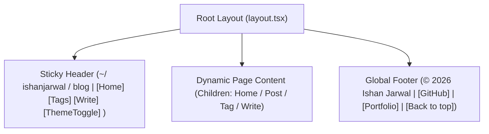
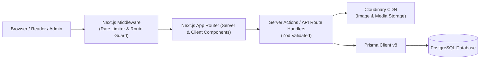

# System Architecture & Blueprint: minimal-blog

This document serves as the single source of truth for the **minimal-blog** project. It specifies the design system, architectural decisions, data models, API contracts, security guardrails, and deployment topography.

---

## 1. Project Overview & Philosophy

`minimal-blog` is a developer-first personal blogging platform. It is engineered to host technical articles, engineering deep dives, and system design notes at `blog.myportfolio.com`.

### Core Principles
1. **Visual Parity & Seamless Integration**: Strictly matches the terminal/GitHub README aesthetic of [ishanjarwal.com](https://ishanjarwal.com). Starts directly at the articles feed on the homepage without duplicated bio/avatar intros.
2. **shadcn Theme Integrity**: Standard shadcn CSS variable names in `globals.css` are preserved without custom variable renaming, so any shadcn component installs and renders seamlessly.
3. **No Arbitrary Color Values**: Strictly use semantic theme variables (`bg-card`, `text-primary`, `border-border`, `text-muted-foreground`) and standardized Tailwind palette utilities rather than arbitrary hardcoded hex codes.
4. **Minimalist & Zero-Bloat**: No heavy WYSIWYG text editors, complex auth providers, or superfluous state stores. Uses native markdown with GitHub-flavored styling.
5. **Open-Source Friendly**: Any developer can clone, configure environment variables, and run locally or on their VPS with one command.
6. **Agile & Robust**: Typed end-to-end with TypeScript and Prisma v8, validated with Zod, protected with rate limiting, and containerized with Docker.

---

## 2. Design System & Visual Specification

The design mirrors the personal portfolio `minimal-portfolio` exactly.

### 2.1 Aesthetic Archetype: GitHub README / Terminal UI
- **Border Radius**: `0px` globally (`--radius: 0px`). All buttons, badges, cards, inputs, and popovers have sharp rectangular corners.
- **Typography**: `Geist Mono` / `monospace` across the entire application (`--font-mono`, `text-[14px] leading-relaxed`).
- **Interactive Elements**: Distinct bracketed links e.g. `[Read More ->]`, `[Back to top ↑]` with standard underlined blue hyperlink accents.

### 2.2 Color Tokens & Theme Palette

The application uses `next-themes` with light/dark class switching.

| Token | Light Theme (`:root`) | Dark Theme (`.dark`) | Notes |
|---|---|---|---|
| `--background` | `#f6f8fa` | `#010409` | GitHub canvas background |
| `--foreground` | `#1f2328` | `#e6edf3` | GitHub text color |
| `--card` | `#ffffff` | `#0d1117` | Component card background |
| `--card-foreground` | `#1f2328` | `#e6edf3` | Card content color |
| `--border` | `#d0d7de` | `#30363d` | GitHub element border |
| `--input` | `#d0d7de` | `#30363d` | Form controls |
| `--muted` | `#f6f8fa` | `#161b22` | Muted block background |
| `--muted-foreground` | `#656d76` | `#8b949e` | Secondary/meta text |
| `--accent` | `#eaeef2` | `#21262d` | Hover state background |
| `--accent-foreground`| `#1f2328` | `#e6edf3` | Hover text |
| `--link` (Hyperlinks)| `#0969da` | `#58a6ff` | Classic GitHub blue underlined |
| `--destructive` | `#cf222e` | `#f85149` | Danger alerts & delete actions |

### 2.3 Global Layout



- **Header**:
  - Sticky at top: `sticky top-0 z-40 w-full border-b border-border bg-card/95 backdrop-blur-xs font-mono`.
  - Brand link: `~/ ishanjarwal / blog` with avatar icon.
  - Desktop nav links: `[Home]`, `[Tags]`, `[Portfolio ->]`, and secret/admin `[Write]`.
  - Theme Toggle: Monospace button switching between light (`Sun`) and dark (`Moon`).
- **Footer**:
  - Top border `border-t-2 border-border`, copyright statement, quick links to GitHub, LinkedIn, main portfolio, and `[Back to top ↑]` smooth scroll.

---

## 3. System Architecture & Routing



### 3.1 Route Breakdown

1. `/` (Home Feed):
   - Starts directly at the `## Latest Articles` section (no duplicated profile picture or intro banner).
   - Post items display: Title, short description, publication date, read time estimate, tags (`#tag`), and an **optional thumbnail** (conditionally rendered only if provided).
   - Offset/cursor-based pagination (`?page=1`).
2. `/blog/[slug]` (Blog Detail):
   - Full post reader with metadata banner (Author, dates, reading time).
   - Sanitized markdown rendering with syntax-highlighted code fences, blockquotes, callouts, and inline media.
   - Tag list with links to `/tag/[slug]`.
   - Edit button (`[Edit Post]`) visible only when admin session is active.
3. `/tag/[slug]` (Tag Feed):
   - Displays all posts associated with a specific tag (e.g., `/tag/operating-systems`).
   - Summary count and tag header.
4. `/write` (Admin Post Creator):
   - Dev.to-style dual tab interface: `[Write]` (Markdown) and `[Preview]` (Real-time rendered HTML).
   - Form fields: Title, slug (auto-generated from title with override option), short description, thumbnail URL (with direct Cloudinary upload button), tags input, published toggle.
   - Markdown toolbar helper: Headers, Bold, Italic, Code block, Quote, Image upload helper, Video embed helper.
5. `/blog/[slug]/edit` or `/write/[id]` (Admin Post Editor):
   - Reuses the write studio preloaded with existing post content.
6. `/api/media/upload` (Media Upload Route):
   - Secure Cloudinary upload endpoint / signed signature generation.
7. `/api/auth/admin` (Admin Gatekeeper):
   - Validates `ADMIN_SECRET_KEY` and sets an httpOnly session cookie for admin privileges.

---

## 4. Database Schema (Prisma v8 + PostgreSQL)

We use **Prisma v8** targeting PostgreSQL. The schema is clean, relational, and indexed for search, tag filtering, and fast pagination.

### 4.1 Prisma Schema Definition

```prisma
datasource db {
  provider = "postgresql"
  url      = env("DATABASE_URL")
}

generator client {
  provider = "prisma-client-js"
}

model Post {
  id               String      @id @default(cuid())
  slug             String      @unique
  title            String
  shortDescription String      @db.Text
  content          String      @db.Text
  thumbnailUrl     String?
  published        Boolean     @default(false)
  readTimeMinutes  Int         @default(1)
  publishedAt      DateTime?
  createdAt        DateTime    @default(now())
  updatedAt        DateTime    @updatedAt

  tags             PostTag[]

  @@index([published, publishedAt(sort: Desc)])
  @@index([slug])
  @@map("posts")
}

model Tag {
  id        String    @id @default(cuid())
  name      String    @unique
  slug      String    @unique
  createdAt DateTime  @default(now())

  posts     PostTag[]

  @@index([slug])
  @@map("tags")
}

model PostTag {
  postId String
  tagId  String

  post   Post @relation(fields: [postId], references: [id], onDelete: Cascade)
  tag    Tag  @relation(fields: [tagId], references: [id], onDelete: Cascade)

  @@id([postId, tagId])
  @@index([tagId])
  @@index([postId])
  @@map("post_tags")
}
```

### 4.2 Key Schema Highlights
- **`Post.shortDescription`**: Explicit teaser text for card previews and SEO meta description.
- **`readTimeMinutes`**: Automatically calculated upon saving (words / 200 wpm).
- **Relational Tags (`Tag` & `PostTag`)**: Enables efficient querying like: "Find all published posts with tag `linux` ordered by `publishedAt DESC`".
- **Indexes**: Fast lookups by slug and compound index on `[published, publishedAt]` for sub-millisecond home feed queries.

---

## 5. Dev.to-Style Editor & Media Pipeline

### 5.1 Editor Requirements
- **No Heavy Rich-Text WYSIWYG**: Avoid ProseMirror/Draft.js complexity. We utilize a responsive raw Markdown textarea with tab switching (`Write` vs `Preview`).
- **Real-Time Preview**: Fast markdown parsing with `react-markdown` + `remark-gfm` + `rehype-highlight` / `rehype-shiki`.
- **Keyboard Shortcuts**: Tab indentation, `Ctrl+B` (Bold), `Ctrl+I` (Italic), `Ctrl+K` (Link).

### 5.2 Cloudinary Upload Pipeline
1. In the `Write` tab, clicking `[Upload Image]` triggers a file selector.
2. The image is uploaded to `/api/media/upload` (validated with admin session).
3. The server uploads the file stream to Cloudinary folder `minimal-blog/posts`.
4. Returns the secure HTTPS URL (`https://res.cloudinary.com/...`).
5. The editor automatically inserts `` at the cursor position.
6. The thumbnail field also supports direct upload or manual URL entry.

### 5.3 Video Embeds
Supports markdown-friendly embeds:
- YouTube: `https://www.youtube.com/watch?v=VIDEO_ID` parsed in the preview/blog reader into an accessible, responsive `<iframe>` or custom component.
- Direct MP4: Standard HTML5 `<video controls>` or markdown video syntax.

---

## 6. Security, Authentication & Rate Limiting

Since this is a personal blog, we avoid bloated user tables and OAuth providers.

### 6.1 Admin Protection Architecture
- A secret environment variable `ADMIN_SECRET_KEY` is configured on the server.
- To access `/write` or `/blog/[slug]/edit`:
  - The admin provides the passkey via a minimal terminal-like prompt or login dialog.
  - Upon verification, an encrypted, `httpOnly`, `SameSite=Lax`, `Secure` cookie (`blog_admin_token`) is issued.
  - Next.js middleware and Server Actions verify this cookie before permitting any write, edit, or delete mutations.
  - Direct public access to `/write` without a valid cookie redirects to an admin passkey challenge or home.

### 6.2 Rate Limiting (VPS Safe)
- In-memory sliding window / token bucket rate limiter implemented for API routes and Server Actions.
- Configurable thresholds:
  - Public read routes: 100 requests per minute per IP.
  - Mutations / Media uploads: 10 requests per minute per IP.
- Safeguards VPS resources from automated bot scraping or DDOS attempts without requiring an external Redis instance (though pluggable for Redis if needed).

### 6.3 Content Sanitization & Input Validation
- **Zod Schemas**: Strict schema validation on all inputs (titles, slugs, descriptions, tags, content).
- **Markdown XSS Sanitation**: `rehype-sanitize` applied to markdown rendering so malicious script tags or unsafe event handlers cannot execute.
- **Security Headers**: Content-Security-Policy, X-Content-Type-Options: `nosniff`, X-Frame-Options: `DENY`, Strict-Transport-Security.

---

## 7. Containerization & DevOps Topology

The application will run containerized on a VPS alongside PostgreSQL.

### 7.1 Dockerfile Structure
- Multi-stage build (`deps` -> `builder` -> `runner`).
- Node.js Alpine base.
- Uses Next.js `output: "standalone"` for minimal Docker image size (< 150MB).

### 7.2 Docker Compose Architecture
Three compose files designed to be merged using Docker Compose's multi-file flags:

1. **`compose.yml`** (Base Configuration):
   - Defines `app` and `db` (Postgres) services, networks, and persistent data volumes.
2. **`compose.dev.yml`** (Development Override):
   - Mounts source code volumes for live hot-reloading.
   - Exposes local ports (App: 3000, DB: 5432).
   - Connects to local dev `.env.development`.
3. **`compose.prod.yml`** (Production Override):
   - Builds production standalone image.
   - Disables exposed DB ports (only reachable on internal Docker bridge).
   - Configures restart policies (`unless-stopped`), resource limits, and production logging.

**Commands**:
- Dev: `docker compose -f compose.yml -f compose.dev.yml up`
- Prod: `docker compose -f compose.yml -f compose.prod.yml up -d`

---

## 8. Directory & File Organization

```
minimal-blog/
├── .agent/
│   ├── WIKI.md              # System blueprint (this file)
│   └── PLAN.md              # Agile development roadmap
├── .env.development         # Development environment config
├── .env.production          # Production environment config
├── compose.yml              # Base Docker compose configuration
├── compose.dev.yml          # Development Docker compose overrides
├── compose.prod.yml         # Production Docker compose overrides
├── Dockerfile               # Production multi-stage Docker build
├── prisma/
│   └── schema.prisma        # Prisma v8 schema definition
├── public/                  # Static assets & favicon
├── src/
│   ├── app/
│   │   ├── (public)/
│   │   │   ├── page.tsx               # Home feed with pagination
│   │   │   ├── blog/[slug]/page.tsx   # Blog post reader
│   │   │   └── tag/[slug]/page.tsx    # Tag collection feed
│   │   ├── (admin)/
│   │   │   ├── admin/page.tsx         # Admin unlock / key challenge
│   │   │   ├── write/page.tsx         # Dev.to write studio
│   │   │   └── blog/[slug]/edit/page.tsx # Edit existing post
│   │   ├── api/
│   │   │   ├── auth/route.ts          # Admin session verification
│   │   │   └── media/upload/route.ts  # Cloudinary upload handler
│   │   ├── globals.css                # GitHub README theme & variables
│   │   └── layout.tsx                 # Root layout with Header & Footer
│   ├── components/
│   │   ├── editor/
│   │   │   ├── devto-editor.tsx       # Write & Preview dual tab editor
│   │   │   └── media-uploader.tsx     # Cloudinary modal/inline uploader
│   │   ├── layout/
│   │   │   ├── header.tsx             # Terminal-style top bar
│   │   │   ├── footer.tsx             # Footer matching ishanjarwal.com
│   │   │   └── theme-toggle.tsx       # Sun/Moon theme toggle
│   │   ├── markdown/
│   │   │   └── markdown-renderer.tsx  # Sanitized reader with syntax highlight
│   │   └── ui/                        # shadcn/ui components (0px radius)
│   ├── lib/
│   │   ├── auth.ts                    # Admin session check & cookie helpers
│   │   ├── cloudinary.ts              # Cloudinary API client
│   │   ├── db.ts                      # Prisma client singleton
│   │   ├── rate-limit.ts              # In-memory sliding window rate limiter
│   │   └── utils.ts                   # Reading time & slug generators
│   └── types/
│       └── blog.ts                    # Shared TypeScript interfaces
├── README.md                # Project documentation
└── package.json
```
